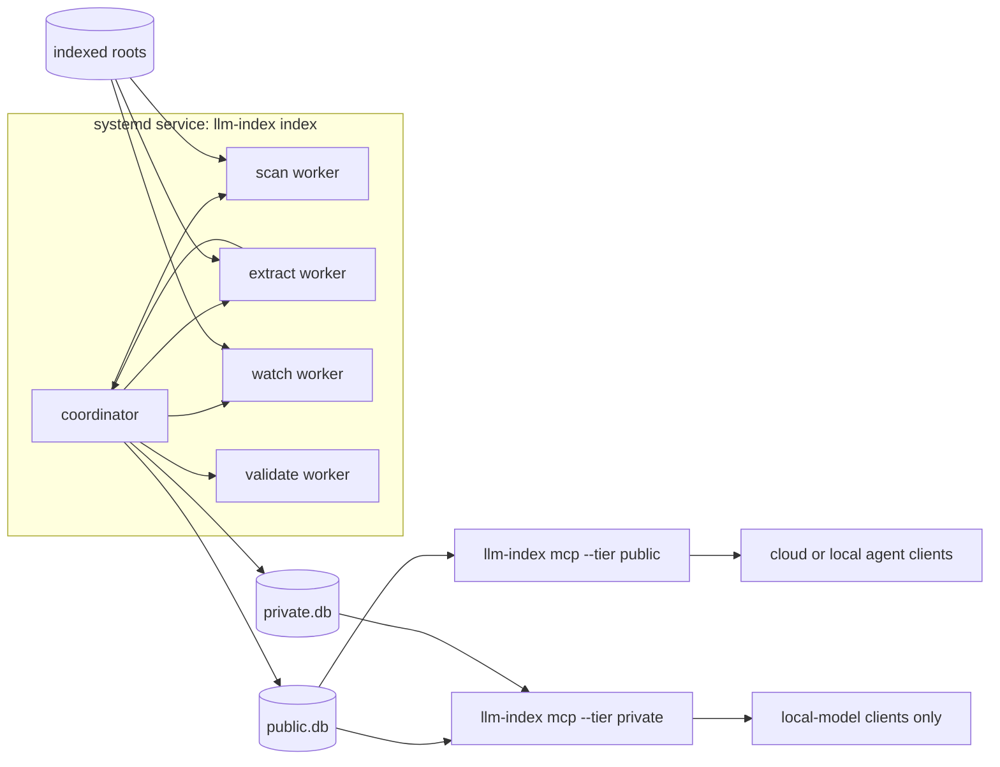

# Architecture

How llm-index is put together. For depth, see the design records of the first
release: [intent](../intent/2026-11-11-1-llm-index.md),
[spec](../spec/2026-11-11-1-llm-index.md) and
[plan](../plan/2026-11-11-1-llm-index.md).

## Overview

- The **coordinator** (`llm-index index`) is the only long-running process. It
  schedules workers and is the only writer of the databases.
- **Workers** are short-lived child processes, one role each: `scan` (walk a
  root), `extract` (parse files), `watch` (inotify), `validate` (check root and
  exclusion paths). Each runs inside a Landlock sandbox. See
  [security](security.md).
- Two SQLite databases live in the state directory. Public roots go to
  `public.db`, private roots to `private.db`.
- Each MCP server (`llm-index mcp`) is started by a client, speaks stdio, and
  only reads. The public server opens `public.db` only.

## Indexing flow

1. **Scan.** A worker walks the root and reports files with size and
   modification time. Unchanged files are skipped. Ignore rules come from
   `.gitignore`, `.ignore`, `.llmindexignore` and the global git ignore file.
2. **Extract.** A worker reads each new or changed file and extracts text, a
   title and structure (pages, rows, headings, code declarations). Supported
   types and limits are in [reference](reference.md#what-is-indexed).
3. **Chunk.** Text is split into passages along that structure.
4. **Embed.** Each passage is turned into a 512-dimension vector.
5. **Store.** Passages, vectors and the file record are committed to the
   right database.

A file that fails to extract is recorded with state `failed` and a reason. It
is not retried until its size or modification time changes.

## Watching

- **Local roots** are watched with inotify, so edits show up in seconds. A full
  reconcile scan runs every 24 hours as a backstop.
- **Network roots** are polled: rescanned every `interval`.
- If the watcher cannot keep up (the inotify watch limit is reached or its
  event queue overflows), the root is marked `degraded` and polled every two
  minutes until the watcher recovers.

## Network shares

Each distinct share gets at most one live worker at a time, so a hung mount
cannot use up the worker pool. When a worker on a share stops making progress,
the share and its roots go `offline` and are retried after 60 seconds, with the
wait doubling up to `limits.backoffMax`. Files from an offline root stay
searchable and are marked `stale`. Nothing from an unverified share is
indexed. See [installation](installation.md#network-roots).

## Search and ranking

- **Words:** SQLite FTS5 with the `unicode61` tokenizer, diacritics removed.
- **Meaning:** passage vectors are 512-dimension and stored as 8-bit integers;
  the query is embedded the same way and compared.
- **Hybrid** (the default) combines both rankings. Without an embedding model
  it falls back to words.

## The embedding model

Embeddings come from `potion-retrieval-32M` (model2vec), a static model:
token vectors are averaged, with no neural network to run at query time. It is
pinned by hash, ships in the package, and needs no network, no GPU and no
remote service. The chat model of your agent is separate. Why this model was
chosen: [feasibility](feasibility.md). Measured cost: [benchmark](benchmark.md).

## Crash containment

Parsers handle hostile files, so a crash must stay local.

- A file that fails to parse, runs past the 30 second limit, or exhausts
  memory fails only that file.
- If an extract worker dies while other work was running next to it, the file
  gets one retry on its own, in a worker with nothing else running. If it
  dies again, or had no company, the file is recorded as `failed` with the
  reason `worker died`.
- Workers have a limited address space, no core dumps, and are the first
  target of the OOM killer. The coordinator and the MCP servers are not
  affected.
