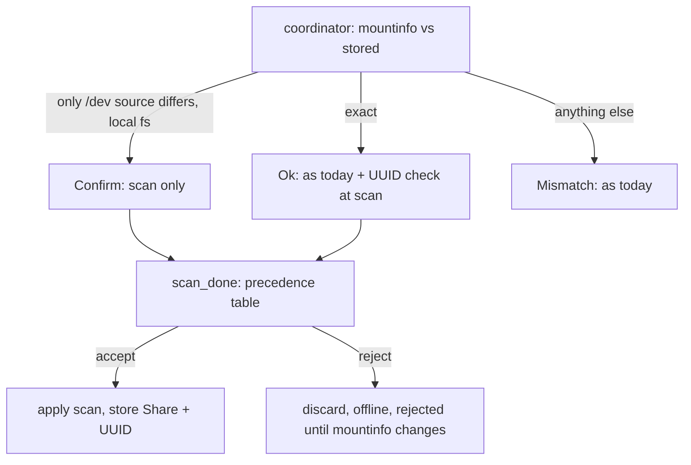

# Spec: a root keeps its identity when the kernel renames its disk

## Design

Keep the mountinfo identity (`Share`) exactly as it is, and add the
filesystem's UUID as a second, stable fact that only the scan worker reads.

- The coordinator keeps judging from mountinfo alone and never opens a root.
- When the only difference is the `/dev` device name, it allows one scan and
  nothing else.
- What the scan finds (the UUID, and evidence from the file listing) decides,
  using one precedence table (section 4).
- **"Never weaker" is measured against today's binary.** Today a matching
  mountinfo is trusted. This design trusts it no less, and adds a UUID check
  on top wherever a UUID is known.

### 1. The stable key: `FS_IOC_GETFSUUID` on the root descriptor

- **Where:** `src/worker/scan.rs`.
  - The scan worker already holds the root directory fd opened before the
    sandbox (`sandbox.rs:68`), and checks the mount identity before and
    after the walk (`scan.rs:543-575`, `:613-635`).
  - It now also calls `ioctl(root_fd, FS_IOC_GETFSUUID)`. The request is
    `_IOR(0x15, 0, struct fsuuid2 { u8 len; u8 uuid[16]; })`, which is
    `0x80111500`.
  - A `len` outside 1..=16, or any error, gives `None`. Otherwise the result
    is the first `len` bytes as lowercase hex.
  - It's carried in `MountIdentity.fs_uuid: Option<String>`, before and
    after alike, so the existing `before == after` comparison also catches a
    UUID change mid-scan.
- **Checked on p620 (2026-11-15):**
  - the ioctl works on a plain directory fd for `/`, `/home` and
    `/mnt/code`;
  - `/mnt/code` gives `bdd8461e7d6c42b69cfe39967825dd42`, which equals
    `lsblk -no UUID /dev/sdd1`.
- **Sandbox fit:**
  - it's an ioctl on an fd the worker already holds;
  - Landlock's ioctl right covers device files, not directories;
  - the unit's `SystemCallFilter=@system-service @sandbox`
    (`nix/config.nix:207`) allows `ioctl`;
  - no new path and no `/dev` or `/sys` access. The coordinator is
    unchanged.
- **Coverage:** the ioctl is generic VFS (`super_block.s_uuid`): ext4, XFS
  and btrfs set it. A filesystem without one gives `None`, and only the
  rows of the table that need no UUID apply to it.
- **What the UUID names.** A UUID identifies a filesystem, not a subvolume
  or a bind-mounted subtree. So it **adds** to the mountinfo checks (mount
  point, mount root, filesystem type) and never replaces them.

### 2. Storage

- **New column** `roots.fs_uuid TEXT`. `Store::open` in `Writer` mode adds it
  when missing (`ALTER TABLE roots ADD COLUMN fs_uuid TEXT`). Readers don't
  need it.
- **Same rules as `share_id`:**
  - it moves with the root across tiers (`index/store.rs:338-380`);
  - it is cleared when the root's path changes (`:374`);
  - it is written in the same statement as `share_id`
    (`set_expected_identity`, `:677-690`).
- **Read as three states:**
  - `Absent`: NULL, a legacy root;
  - `Known(U)`: valid hex of 2 to 32 characters;
  - `Unreadable`: an SQL error or a malformed value.

  `expected_identity` stops collapsing errors into "absent" for this field.
- **Rollback to an older binary.**
  - The older binary ignores the column, so it guards exactly as it does
    today (not weaker than before the upgrade).
  - A `share_id` rewritten with the new device name matches its mountinfo.
  - If that older binary moves a root between tiers, it drops `fs_uuid`.
    After upgrading again, the root is `Absent` and re-enrols through the
    evidence rule.

### 3. The coordinator verdict and runtime gate

- **New case in `verdict()`** (`index/shares.rs:57-81`), before the final
  `Mismatch`. It returns **`Confirm`** when:
  - the expected and current `Share` are equal except `source`;
  - both sources start with `/dev/`;
  - the filesystem type isn't a network type (`is_network`,
    `shares.rs:15-20`);
  - and `configured_ok` holds.
- **`adopt_uuid` doesn't widen this case.** A root with `adopt_uuid` set
  also reaches `Confirm` only through the same rule: same filesystem type,
  mount root and mount point, local, and a `/dev` source. A missing btrfs
  subvolume or bind mount falls through to its parent's mount point or
  mount root and stays `Mismatch`, as today.
- **What `Confirm` allows:** a scan only.
  - `may_extract` stays `Ok | Adopt`, so ordinary extraction, `send_next`,
    solo retries and new watchers stay off.
  - The solo queue's head-of-line loop (`sched.rs:920-936`) evicts a
    `Confirm` root's entries the way it evicts a `Mismatch` root's, so
    healthy roots behind it aren't starved.
- **Runtime rejection gate.** When the table (section 4) rejects a scan:
  - the scheduler records `rejected = Some(derived)` for that root, where
    `derived` is the share plus mount ID it was judged against;
  - while the root's derived identity equals that value, `verdict_of`
    returns `Mismatch`, so nothing runs and no rescan loop starts;
  - a mountinfo change (`rederive`) clears the gate;
  - the gate also stops the root's watch worker and drops its queue,
    through the existing `check_identity` `Mismatch` path.

  This covers a disk swapped behind an unchanged `/dev` name, which the
  coordinator alone can't see.
- **`set_state` writes reason changes too** (`sched.rs:199-205`): `RootRt`
  keeps its reason. So `offline / identity check` and
  `offline / identity mismatch` are told apart in `status`.
- **`identity check`** joins the closed reason list in `src/status.rs`.

### 4. The precedence table at `scan_done`

`scan_done` (`index/sched.rs:627-690`) already discards a scan whose before
and after identities differ, and one judged `Mismatch`. For everything else,
it decides by the first row that matches. Here, S is the stored UUID, W the
worker's UUID (before and after, equal), A the root's `adopt_uuid`, and E
the evidence (section 5).

| # | Condition | Result |
| --- | --- | --- |
| 1 | S is `Unreadable` | reject |
| 2 | A is set | accept if `W == A` and the scan is complete, storing S = A; otherwise reject |
| 3 | verdict `Adopt` (the root has no indexed files) | accept, and store S = W (W may be `None`) |
| 4 | S = `Known(U)` | accept if `W == U`; otherwise reject. A `None` W also rejects |
| 5 | S `Absent`, verdict `Ok` | accept as today. Store S = W only if `W` is `Some` and E passes; otherwise stay `Absent` |
| 6 | S `Absent`, verdict `Confirm` | accept if `W` is `Some`, the scan is complete and E passes, storing S = W; otherwise reject |

- **Accepting** applies the scan as today and stores the new `Share` (the
  current device name) with S. `Probe` keeps its meaning: scan once and
  accept nothing.
- **Row 2 is the owner's deliberate action**, for an intentional disk
  replacement or a migration without evidence.
  - It accepts the filesystem with that UUID even if it's empty. The docs say
    so: the index then follows that disk.
  - Once S equals A, rows 2 and 4 agree, so leaving A in place is harmless.
    It keeps pinning that one filesystem.
- **Row 3 keeps today's "deeper mount over an empty root" adoption**
  (`shares.rs:72-79`) working: an empty root has nothing to lose.
- **Row 5 keeps today's behaviour** for a legacy root whose mountinfo still
  matches. It enrols only with evidence, so a wrong disk that appeared under
  the same device name before the first upgraded scan is never written down
  as the expected one.

### 5. Evidence

E holds when the scan is complete, and these counts meet the threshold:

- **Denominator:** every distinct `relpath` in `files` for the root, from
  both tier databases, minus paths under the scan's protected skipped
  subtrees (`apply_scan`'s `protected`, `store.rs:597-602`). Those keep
  their rows without being listed, so they count neither way.
- **Matches:** denominator paths present among the scan's file entries with
  the same `size` and `mtime_ns`.
- **Threshold:** `matches * 10 >= denominator * 9`, with
  `denominator >= 1`.
- **Fails closed:** a database error, or a denominator of 0, means E is
  false.

The rule uses the whole index, not a sample, so a partly restored disk
fails. It reads the `files` table and the scan buffer already in memory.
For p620's 54k files it costs one query and a hash lookup per row. An empty
disk scores 0%.

### 6. `adopt_uuid`

- **Shape:** a per-root config field holding a UUID, canonical
  (`bdd8461e-7d6c-…`) or plain hex.
  - `src/config.rs` validates it as 2 to 32 hex digits once dashes are
    removed, and stores it lowercase.
  - It's exposed through the shared options in `nix/config.nix`, used by the
    HM and NixOS modules.
- **Effect:** table row 2.
- **Finding the UUID:** the owner runs `findmnt -no UUID <mountpoint>` or
  `lsblk -no UUID <device>`. The docs show both.
- **When to remove it:** the docs say to remove it once the root is `ok`,
  though leaving it is safe.

### 7. Docs

- `docs/security.md` gains a section on the identity guard. It covers:
  - what is compared;
  - `Confirm`;
  - the precedence table and evidence;
  - `adopt_uuid`, including that it may accept an empty disk;
  - rollback.
- `docs/reference.md` gains `adopt_uuid` and the `identity check` reason.
- `docs/troubleshooting.md` gains the entry "a root is offline with
  `identity mismatch`".

## Alternatives rejected

- **Replace `source` with the UUID inside `Share`.** The coordinator can't
  read a UUID without opening the root. `Share` is also the backoff key
  (`ShareBook`) and what `share` matches against.
- **Accept any `/dev` source change automatically.** An empty or wrong disk
  at the same mount point would be adopted.
- **Evidence from a sample** (the first draft used 512 rows). A partly
  restored disk holding those rows would pass.
- **`adopt_uuid` overriding every mismatch.** A UUID doesn't tell a btrfs
  subvolume or bind mount from its parent, so a missing one would be
  adopted.
- **`statfs` `f_fsid`.** Not stable on XFS.
- **`/dev/disk/by-uuid` and `/sys` lookups.** These need access the
  processes don't have.
- **A CLI that edits the database.** The service is the only writer, and a
  control path is out of scope (#15).

## Risks

- **Heavy edits while offline.** A root with more than 10% of its files
  changed fails E and needs `adopt_uuid`. That fails closed.
- **Cloned filesystems share a UUID.** A `dd` clone mounted in place counts
  as the same filesystem. It holds the same data, and the docs say so.
- **The pre-scan window is unchanged from today.** After a service start,
  an unchanged mountinfo lets extraction and watch run until the first scan
  checks the UUID. Today they run with no UUID check at all.
- **Kernels before 6.5** give `None`: rows 4 and 6 reject, row 5 behaves as
  today. p620 and razer run 7.3.
- **Migration on p620.** The first scan after deploy walks about 54k files
  in `Confirm` (`identity check`), then applies row 6.
- **Hosts:** p620 and razer only. p510 is untouched.

## Verification

- **Unit tests,** in `shares.rs` and `sched.rs`:
  - every table row and its negative;
  - `Confirm` only for a `/dev` source-only change on a local filesystem
    with `configured_ok`;
  - `adopt_uuid` never reaching `Confirm` across a mount point or mount root
    change;
  - extract, `send_next`, solo and watch off in `Confirm`, and under the
    rejection gate;
  - the gate cleared by `rederive`;
  - solo eviction of a `Confirm` head;
  - `set_state` writing a reason-only change;
  - enrolment at row 5 only with E.
- **Evidence tests:**
  - empty listing;
  - exactly 89% and 90%;
  - one-file root;
  - protected subtree;
  - the same path in both tiers;
  - incomplete scan;
  - a database error.
- **Storage tests:**
  - the column migration on an old database;
  - `fs_uuid` across a tier move and a path change;
  - an `Unreadable` value.
- **Worker test** (`scan.rs`): the ioctl decoding, including a `len` out of
  range.
- **VM check** (`nix/checks/vm.nix`, new stage):
  - an ext4 image made with `mkfs.ext4 -U <known>` is mounted as a root;
  - after the service's first scan under the real unit (sandbox and syscall
    filter on), `roots.fs_uuid` equals the known UUID;
  - remounting the same image as a different device keeps the root `ok`;
  - mounting an empty ext4 image with another UUID at the same point gives
    `offline / identity mismatch` with the index intact.
- `nix flake check`, including the existing network-mounts stage (a missing
  NFS mount still mismatches).
- **Live on p620, after deploy:**
  - `source` goes `identity check`, then `ok` after one scan;
  - file and chunk counts are unchanged, apart from real edits;
  - `fs_uuid` is `bdd8461e…` and `share_id.source` is `/dev/sdd1`.
- **Live on razer:** `source` and `docs` stay `ok` and enrol UUIDs.
