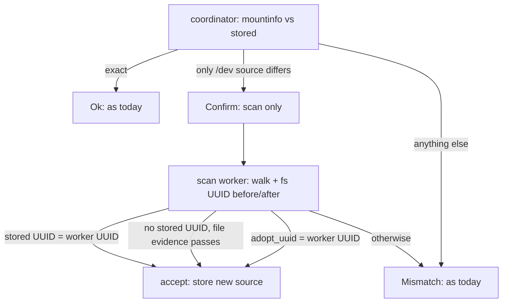

# Spec: a root keeps its identity when the kernel renames its disk

## Design

Keep the mountinfo identity (`Share`) exactly as it is, and add the
filesystem's UUID as a second, stable fact that only the scan worker reads.
The coordinator keeps judging from mountinfo alone, and never opens a root.
When the only difference is the device name, it lets a scan run but nothing
else. The scan's result decides whether to accept the new device name.

### 1. The stable key: `FS_IOC_GETFSUUID` on the root descriptor

- **Where:** `src/worker/scan.rs`. The scan worker already holds the root
  directory fd opened before the sandbox, and checks the mount identity
  before and after the walk (`scan.rs:543-575`, `:613-635`).
  - It now also calls `ioctl(root_fd, FS_IOC_GETFSUUID)`, which returns
    `struct fsuuid2 { u8 len; u8 uuid[16]; }` (`_IOR(0x15, 0, 17)`).
  - The result goes into `MountIdentity` as `fs_uuid: Option<String>`
    (lowercase hex; `None` when the ioctl fails or `len` is 0), in the
    before and after identities alike. The existing `before == after`
    comparison then covers it.
- **Checked on p620 (2026-11-15):**
  - the ioctl works on a plain directory fd for `/`, `/home` and
    `/mnt/code`;
  - `/mnt/code` gives `bdd8461e7d6c42b69cfe39967825dd42`, which equals
    `lsblk -no UUID /dev/sdd1`.
- **Sandbox fit:**
  - it's an ioctl on an fd the worker already has. Landlock's ioctl control
    covers device files only, not directories;
  - the unit's `SystemCallFilter=@system-service @sandbox`
    (`nix/config.nix:207`) allows `ioctl`;
  - no new path, no `/dev` or `/sys` access, and the coordinator is
    unchanged.
- **Coverage:** the ioctl is generic VFS (`super_block.s_uuid`), so it works
  for ext4, XFS, btrfs and every other filesystem that sets a UUID. A
  filesystem without one gives `None`, which behaves as today.
- **Why not `statfs` `f_fsid`:** it's device-number-derived on XFS, so it
  isn't stable there.
- **Why not `/dev/disk/by-uuid`:** it needs `/dev` access the sandboxes
  don't have.

### 2. Storage

- **New column** `roots.fs_uuid TEXT`. `Store::open` in `Writer` mode adds it
  when missing (`ALTER TABLE roots ADD COLUMN fs_uuid TEXT`). Readers never
  need it.
- **Same rules as `share_id`:**
  - it moves with the root across tiers (`index/store.rs:338-380`);
  - it is cleared when the root's path changes (`:374`);
  - it is written in the same statement as `share_id`
    (`set_expected_identity`, `:677-690`).
- **Rollback:** an older binary ignores the column. A `share_id` rewritten
  with the new device name matches its mountinfo, so the older binary works
  on.

### 3. The verdict

`verdict()` (`index/shares.rs:57-81`) gains one case before the final
`Mismatch`:

- **`Confirm`.** The expected and current `Share` are equal except for
  `source`, both sources start with `/dev/`, and the filesystem is not a
  network type (`is_network`, `shares.rs:15-20`).
  - It allows a scan, like `Probe`, but no extract or watch worker
    (`may_extract` stays `Ok | Adopt`).
  - The root shows `offline` with reason `identity check` until the scan
    decides. `identity check` joins the closed reason list in
    `src/status.rs`.
- **The owner action also gives `Confirm`.** A root with a configured
  `adopt_uuid` (section 5) gets `Confirm` instead of `Mismatch`, whatever
  differs, so the deliberate action has a scan to work with.
- **Unchanged:** `Ok`, `Adopt`, `Probe`, and every other `Mismatch`
  (network shares, mount point or root changes, unreadable records,
  `shares.rs:69-71`). The `share` setting compares with `source` exactly as
  now.

### 4. Deciding at `scan_done`

`scan_done` (`index/sched.rs:627-690`) already discards a scan whose before
and after identities differ, or whose verdict is `Mismatch` (including a
fs_uuid change mid-scan). It now also covers a root whose
`fs_uuid = U` is stored:

- **Enrolled check, every verdict:** if the worker reports a different UUID,
  or none, the scan is discarded and the root goes `offline` with
  `identity mismatch`. A disk swapped behind the same device name, or a
  stable key that can no longer be read, fails closed.
- **`Confirm`.** The scan is accepted, and the new `Share` (with the
  worker's UUID) is stored, only when one of these holds:
  1. **Enrolled:** stored `fs_uuid` equals the worker's UUID;
  2. **Legacy evidence** (no stored `fs_uuid`, the p620 case): file
     evidence passes;
  3. **Owner:** the root's `adopt_uuid` equals the worker's UUID.

  Otherwise the result is discarded and the root goes `offline` with
  `identity mismatch`, as today.
- **File evidence:**
  - Up to 512 indexed files of the root are taken, from both tier
    databases, ordered by `id`.
  - At least 90% of them must appear in the scan's listing at the same
    `relpath`, with the same `size` and `mtime_ns`.
  - The root must have at least one indexed file.

  This uses only the scan buffer and the `files` table, with no extra
  filesystem access. An empty disk scores 0%. A different disk scores near
  0% unless it's a byte-for-byte copy with the same timestamps, which is the
  same data.
- **Enrolment:** any scan accepted under `Ok` or `Adopt` on a root with no
  stored `fs_uuid` stores the worker's UUID. razer and every healthy root
  enrol on their next scan with no visible change.

### 5. The owner action: `adopt_uuid`

- **Shape:** a per-root config field `adopt_uuid` (a UUID string,
  canonical or hex) in `src/config.rs`, the HM module and the NixOS module.
- **Effect:** the root can be accepted on the filesystem with that UUID, in
  any mismatch, through a normal scan.
- **Safe to leave in place.** It pins one specific filesystem: a missing,
  empty or different disk still has a different UUID and stays offline. That
  makes it declarative and reviewable, with no control socket. The docs say
  to remove it once the root is back to `ok`, and that it's the way through
  an intentional disk replacement.
- **Finding the UUID:** the owner runs `findmnt -no UUID <mountpoint>` or
  `lsblk -no UUID <device>`. The docs show both.

### 6. Docs

- `docs/security.md` gains a section on the identity guard: what is
  compared, `Confirm`, the evidence rule and `adopt_uuid`. It isn't
  described anywhere today.
- `docs/reference.md` gains the `adopt_uuid` setting and the
  `identity check` reason.
- `docs/troubleshooting.md` gains the entry "a root is offline with
  `identity mismatch`".

## Alternatives rejected

- **Replace `source` with the UUID inside `Share`.** The coordinator can't
  read a UUID without opening the root. `Share` is also the backoff key
  (`ShareBook`, `shares.rs:92`) and what `share` matches against.
- **Accept any `/dev` source change automatically.** An empty or wrong disk
  at the same mount point would be adopted and its scan would wipe the index
  (intent: "never weaker").
- **`statfs` `f_fsid`.** Not stable on XFS.
- **`/dev/disk/by-uuid` or `/sys/dev/block` lookups.** These need access the
  coordinator and workers don't have.
- **A one-shot "adopt current" flag.** If left in the config, it would
  disable the guard for that root for good. `adopt_uuid` pins one
  filesystem instead.
- **A CLI that edits the database.** The service is the only writer, and a
  control path is out of scope (#15 decision).

## Risks

- **Evidence threshold.** A root edited heavily while offline (more than 10%
  of its sampled files changed) fails the evidence check and needs
  `adopt_uuid`. That's acceptable, because it fails closed. For p620 today,
  the source tree is mostly unchanged since 2026-11-14.
- **Cloned filesystems share a UUID.** A `dd` clone mounted in place is
  accepted as the same filesystem. That's the same data, so it's the
  intended outcome. The docs say so.
- **A kernel without `FS_IOC_GETFSUUID`** (before 6.5): `None`, so behaviour
  is as today. p620 and razer run 7.3.
- **Migration on p620.** The first scan after deploy runs in `Confirm`,
  walks about 54k files, then evaluates the evidence. Until it finishes,
  `source` shows `identity check`.
- **Hosts:** p620 and razer only. p510 is untouched.

## Verification

- **Unit tests,** in `shares.rs` and `sched.rs`:
  - `verdict` gives `Confirm` only for a `/dev` source-only change on a
    local filesystem;
  - each `scan_done` path: enrolled match and mismatch, missing UUID on an
    enrolled root, evidence pass and fail (empty listing, 89% and 90%), and
    `adopt_uuid` match and mismatch;
  - enrolment on `Ok`;
  - tier move and path change for `fs_uuid`;
  - extract and watch held while in `Confirm`.
- **Worker test,** in `scan.rs`: `fs_uuid` is `Some` on the test's tmpfs or
  ext4, or `None` where unsupported, and is equal before and after.
- **The column migration test:** an old database gains `fs_uuid` and keeps
  `share_id`.
- `nix flake check`, including the VM checks. The network-mounts VM stage
  must still mismatch on a missing NFS mount.
- **Live on p620, after deploy:**
  - `source` goes `identity check`, then `ok` after one scan, with no
    reindex (file and chunk counts unchanged ±edits);
  - `roots.fs_uuid` equals `bdd8461e…`;
  - `share_id.source` reads `/dev/sdd1`.
- **Live on razer:** `source` and `docs` stay `ok` and enrol a UUID.
