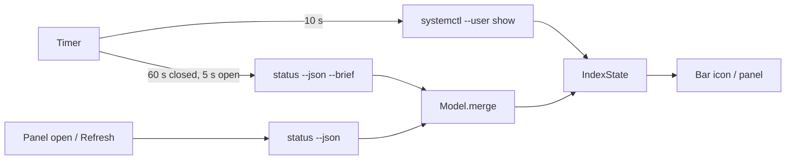

# Spec: an Omarchy shell plugin for llm-index status and settings

## Design

Two parts:

- this repository adds a machine-readable status and ships the plugin;
- nixos_config installs it on p620 and razer.

The plugin is QML only. All parsing, tier logic, normalisation and redaction
stay in Rust, where the public MCP's rules already live.

### 1. `llm-index status --json [--brief]` (Rust)

- `src/main.rs:55`: `Status` gains `--json` and `--brief`. `--brief` requires
  `--json`. Without `--json`, the text output is unchanged byte for byte.
- `src/status.rs`: `run` takes the two flags. JSON mode prints one object on
  stdout and nothing else. Errors keep exit code 2 and go to stderr
  (`src/main.rs:142-148`). The plugin discards stderr (section 2).
- **`--brief` never runs the file and chunk counts.**
  - `build` branches before preparing those queries (`status.rs:65-68`,
    `:105-106`), and `files` and `chunks` are `null` in every row.
  - What remains reads the `roots`, `validated` (via `Store::begin`,
    `db.rs:192`) and `config_errors` tables. They are small, and
    `queued`/`done` are kept live (`index/store.rs:583`, `:633`).
  - Measured on p620 on 2026-11-15: the `roots` reads take about 3 ms against
    3.1 s for full `status`. Whole-command timings are measured as part of
    verification.
- **Normalised rows (JSON only).** In the owner view (`build(store, false)`):
  - `state` `""` becomes `pending`. The scheduler inserts `''`
    (`index/store.rs:371`) and only the public branch normalises it today
    (`status.rs:91-97`).
  - A root missing from `roots` is `pending`, with `null` reason, last scan,
    queued, done and counts.
  - An empty `reason` (written for `ok`, `sched.rs:481`, `:694`) becomes
    `null`.
- **Reasons from a closed list.** A reason is kept if it passes the existing
  `public_reason` (`status.rs:33`: a state word, `mount`, an errno name) or is
  one of these scheduler reasons:
  - `identity mismatch`, `watch degraded`, `watcher exited`,
    `watch setup stalled`, `stdin blocked`, `no progress`;
  - `extract timeout`, `scan timeout`, `worker died`, `disk full`,
    `symlink in path`.

  Anything else, including worker-supplied text such as
  `WatchDegraded { reason }` (`sched.rs:494`) that can hold a path, becomes
  `other`. The plan step confirms the list against every `set_state`,
  `mark_degraded` and `abandon` call site in `src/index/` and `src/worker/`.
- **Config errors, path-free.** Each becomes
  `{"root": <name|null>, "what": "root"|"exclusion"|"unknown", "reason": <filtered>}`:
  - **exact match:** the error path equals a configured root's path, so
    `root` is that root and `what` is `root`;
  - **otherwise:** the deepest configured root that contains the path by
    whole path components (`/data/a` contains `/data/a/x`, not `/data/ab`),
    with `what` `exclusion`. Nested roots are allowed (`config.rs:174-192`),
    so the deepest one wins;
  - **no match:** a stale row left from an old config before
    `prune()` (`index/store.rs:431-442`) gives `root: null`, `what: unknown`;
  - the path itself never appears (intent decision 4).
- **Settings projection**, from the parsed `Config` (`config.rs:11-76`), path
  free:

  ```json
  "settings": {
    "roots": [{"name": "...", "tier": "public|private", "kind": "...", "interval": "...", "share": true}],
    "exclusions": 1,
    "lifted_builtin": 0,
    "limits": {"max_file_mb": 0, "max_text_bytes": 0, "max_cells": 0,
               "memory_max_mb": 0, "workers": 0, "backoff_max": "..."}
  }
  ```

  - `share` is a boolean: the share source names a device or server.
  - `lifted_builtin` is a count. The entries are unvalidated glob strings
    (`config.rs:58`), so they aren't shown.
- Top-level `"generated_at"` (Unix seconds) and `"brief": true|false`.
- The MCP `status` tool and `build(_, true)` are unchanged.

### 2. The plugin (`plugin/` in this repository)

ID `olafkfreund.llm-index` (intent decision 5). It follows rebuild-panel,
which ships with nixarchy: a self-hiding bar widget, a singleton state with
acquire and release, and the Process plus StdioCollector pattern.

| File | Role |
| --- | --- |
| `manifest.json` | `schemaVersion: 1`, `kinds: ["bar-widget"]`, `entryPoints.barWidget: "Panel.qml"`, `barWidget` with `category: "System"`, `allowMultiple: false`, `defaultSection: "right"`. |
| `qmldir` | `singleton IndexState IndexState.qml`, and `Model.js`. |
| `Model.js` | Pure functions: validate a JSON snapshot, merge snapshots, map the unit state, compute `level` and the tooltip, format numbers and ages. Holds all the logic, so it can be tested without a shell. |
| `IndexState.qml` | `pragma Singleton`, with `acquire()` and `release()` like `RebuildState.qml:1` and `Panel.qml:25`. One set of processes and timers for every monitor's widget. |
| `IndexView.qml` | Panel content: Status and Settings tabs, the action row, and a `ConfirmDialog` for Restart. |
| `Panel.qml` | `BarIconButton` sized 0 when the level is `ok` and the panel is closed (`rebuild-panel/Panel.qml:50-51`, `:83-84`), plus a `KeyboardPanel` hosting `IndexView` and the `IpcHandler`. |

#### Data flow and rates



- **Background (no panel open):**
  - `systemctl --user show llm-index.service -p ActiveState -p SubState -p Result`
    every 10 s, with a 5 s deadline;
  - `llm-index status --json --brief` every 60 s, with a 10 s deadline.
- **Panel open:**
  - one full `status --json` on open and on Refresh (about 3 s, with a busy
    marker), with a 60 s deadline;
  - `--brief` every 5 s.
- **At most one process of each kind runs at once.** A tick that finds its
  process still running is skipped. A process past its deadline is killed
  and counts as a failure.
- **Merge rule** (`Model.merge`, tested):
  - live fields (each root's state, reason, last scan, queued and done, the
    config errors) come from whichever response has the newer
    `generated_at`;
  - a response older than the current live fields doesn't change them;
  - file and chunk counts and `settings` come only from full responses and
    keep their own `generated_at`, shown as "counts as of …";
  - a brief response never nulls them.
- **stderr is discarded.** Every Process has a stderr collector that is
  never read, logged or shown. A failure maps to one fixed category:
  - `not installed` (the process fails to start);
  - `status failed` (non-zero exit);
  - `bad output` (invalid JSON or the wrong shape);
  - `timed out`.

  The plugin contains no `console.*` or `print` calls (enforced by the lint,
  section 3).
- **Unit state:**
  - `active` gives `running`;
  - `activating`, `deactivating` and `reloading` give `starting`;
  - `failed` gives `failed`;
  - `inactive` gives `stopped`;
  - anything else, or a failed or timed-out query, gives `unknown`.

  `SubState` and `Result` are shown in the panel header and don't affect the
  level.

**Level, in priority order** (`Model.js`):

| Level | When | Tooltip |
| --- | --- | --- |
| `down` | the unit is `stopped`, `failed` or `unknown` | "llm-index: service not running" |
| `problem` | any root `offline`, `degraded` or `config_error`; any config error; the last brief failed, or the live data is older than 3 brief periods | "llm-index: needs attention" |
| `indexing` | any root `pending`, a root with null `last_scan`, or `queued >= 1000` (named constant) | "llm-index: indexing" |
| `ok` | otherwise | "llm-index: ok" (seen only while the panel is open) |

The bar icon draws whenever the level isn't `ok` or the panel is open.
Private roots count (intent decision 3). Tooltips are fixed strings with no
names or numbers. `BarIconButton` renders its tooltip as plain text already
(`Ui/WidgetButton.qml:119`).

**IPC:** the target is `olafkfreund.llm-index.bar`, with `manageIpc: false`
as in rebuild-panel.

- It offers `toggle`, `open` and `close`.
- `status()` returns `{"level": "<level>"}` and nothing else.

**Actions:**

- **Refresh:** a full `status --json`.
- **Restart service:** behind `ConfirmDialog`.
  - While the dialog is open, `PanelKeyCatcher.blocked` is true and a
    `Keys.onPressed` on the dialog's focus item passes events to
    `ConfirmDialog.handleKey` (`Ui/ConfirmDialog.qml:24-40`).
  - The view keeps a minimum height so the dialog isn't clipped
    (`KeyboardPanel.qml:225`).
  - Confirming runs `systemctl --user restart llm-index.service`, then
    refreshes. The unit's `ExecStartPre` runs the sandbox self-test
    (`nix/config.nix:194`).
- **Open log:** `omarchy-launch-floating-terminal-with-presentation
  journalctl --user -fu llm-index`, the helper rebuild-panel uses
  (`RebuildState.qml:133-136`).
  - The journal can contain private paths. The owner opens it explicitly, in
    a terminal, not the shell.

**Settings tab:** shows the projection and the line "Managed by Nix:
`services.llm-index` in Home Manager. Change it in your system
configuration and rebuild." It has no edit controls.

**Text safety:** every `Text` (including `PanelSectionHeader`, which is a
`Text`, `Ui/PanelSectionHeader.qml:8`) sets `textFormat: Text.PlainText`.
There are no links.

**The binary:** the plugin runs `llm-index` from the session PATH. The host
module installs `cfg.package` (nixos_config
`hosts/common/nixos/llm-index.nix:47`). It uses the default config path
(`config::default_path`), the same file the HM unit reads.

### 3. Packaging and checks (this repository)

- `flake.nix`:
  - `packages.${system}.plugin`, a copy of `plugin/` (without `tests/`) made
    with `lib.fileset`, separate from the Rust package's fileset;
  - `checks.${system}.plugin`, which runs three things:
    - **`qmllint` syntax checks** like nixarchy `tests/qml.nix:14-21`. The
      `qs.*` imports don't resolve outside the shell, so this checks syntax
      only.
    - **A lint script** (`plugin/tests/lint.sh`, which reads files and
      tracks QML object blocks).
      - It fails when a `Text`, `PanelSectionHeader`, `Label`, `TextEdit`
        or `TextInput` block lacks `textFormat: Text.PlainText` in that
        same block.
      - It also fails on any `console.` or `print(`, on any `sh -c`, and on
        `Qt.openUrlExternally`.
      - It has a self-test against a broken fixture, as `tests/qml.nix:39-43`
        does.
    - **`qmltestrunner` offscreen** on `plugin/tests/tst_model.qml`. It
      covers `Model.js`:
      - the level table;
      - the merge rule, including reversed completion order and a brief
        response after a full one;
      - unit-state mapping;
      - an initial failure, a failure after success, and recovery;
      - shape validation.
- Rust tests in `src/status.rs`:
  - the JSON shape;
  - `--brief` gives null counts **and runs no count query**: a fixture
    database whose `chunks` table is renamed still succeeds with `--brief`
    and fails without it;
  - the normalisation (`""` becomes `pending`, an empty reason becomes
    `null`, a missing row);
  - the closed reason list;
  - config-error mapping (exact match, nested roots, `/data/a` against
    `/data/ab`, stale row), with no input path anywhere in the output;
  - `lifted_builtin` as a count;
  - text output unchanged;
  - no private root in `build(_, true)` (already covered, kept).

### 4. nixos_config (a separate PR, after this repository merges)

In `hosts/common/nixos/llm-index.nix`, for both hosts:

- `programs.nixarchy.plugins."olafkfreund.llm-index".src` set to the
  `plugin` package, in the user's Home Manager block.
- **Enabled once** with `local.omarchy.enableOnce = [ "olafkfreund.llm-index" ]`
  (import `omarchy-enable-once.nix`, as `omarchy-gmessages.nix` does).
  - It leaves a marker per host, so a later disable sticks, and it never
    writes `shell.json` (`omarchy-enable-once.nix:1-3`).
  - It runs from the shell's `post-boot.d` hooks.
- **Keybinding:** `local.omarchy.keys.extra` gets `SUPER + CTRL + ALT + I`,
  "llm-index", with action
  `omarchy-shell shell toggle olafkfreund.llm-index '{}'`.
  - It is the same route as the herdr and govee keys
    (`omarchy-keys.nix:150`, p620 `nixarchy.nix:246`).
  - The chord is unused in `omarchy-keys.nix` and the host files, and a
    duplicate fails the build (`omarchy-keys.nix:319-323`).
- **Menu row:** `programs.nixarchy.menu.extraEntries."apps.llm-index"`, with
  the same toggle action. This is the declared extension point (nixarchy
  `modules/apps.nix:1098-1112`), used for podman at
  `omarchy-keys.nix:294-309`.
- The flake input is bumped to the merge commit.

**Two departures from the intent's assumed defaults**, both for you to
confirm:

- **Q1, enable:** instead of enabling it by hand, use the existing
  `enableOnce`. It gives the same "on once, your later disable sticks"
  result with no manual step and no nixarchy change.
- **Q2, way in:** a plugin can't add a menu row itself, so the menu row
  comes from nixos_config's `extraEntries`, alongside the keybinding.

### 5. Docs

- `docs/reference.md`: `status --json` and `--brief`, with the field list,
  the reason list and the config-error mapping.
- `README.md`: a short "Desktop plugin" section.
- `docs/security.md`: what the plugin shows where.
  - Private metadata appears only in the open panel.
  - The tooltip and IPC carry a level only.
  - stderr is discarded.
  - Open log is the explicit exception.

## Alternatives rejected

- **A standalone Omarchy app (C++/Qt).** It needs a window, its own backend,
  packaging and theme code for a status panel. Comparable system surfaces
  (rebuild, podman, herdr) are shell plugins.
- **A `menu`-kind overlay.** It's a full-screen overlay
  (`nixarchy.podman/Menu.qml:106-148`), too big for a status card. The bar
  widget can be summoned with `omarchy-shell shell toggle`
  (`shell.qml:1190-1242`).
- **Parsing the text `status`.** It's fragile, and it carries paths in
  config errors.
- **QML reading SQLite directly.** That bypasses the Rust visibility and
  redaction rules, and Quickshell has no SQLite.
- **A daemon-written status file or socket.** It's new daemon surface the
  intent excludes. `--brief` is already cheap.
- **Settings through the barWidget `schema`.** No renderer exists in the
  shell tree. The rates and threshold are constants.
- **Showing the reason allowlist as free text with paths stripped by a
  regex.** Too easy to get wrong; a closed list fails safe.

## Risks

- **#14 first.** Until #14 is fixed, p620's `source` is offline, which is
  correct but means `problem` from day one. The plan sequences #14 first
  (intent decision 6).
- **Shell drift.** `omarchy-launch-floating-terminal-with-presentation`,
  `omarchy-shell` and the `qs.Ui` components come from the Omarchy tree.
  Syntax-only `qmllint` can't catch a wrong property on a `qs.Ui` component;
  only loading in the real shell does.
  - Mitigation: use only what rebuild-panel uses, and check live on p620
    before razer.
- **Summoning depends on the bar.** `shell toggle <id>` reaches a bar widget
  through `shell.bar.summonBarWidget` (`shell.qml:1219-1224`). p620 runs the
  default bar (`shell.json` sets no bar plugin), and the same route already
  serves the herdr and govee keys. A host that switches to a third-party bar
  could break it. Checked live.
- **`enableOnce` timing.** `rescanPlugins` is asynchronous
  (`PluginRegistry.qml:752-784`) and the enable runs right after it. If the
  first run misses the new plugin, there's no marker, so the next session
  retries. Verification includes a re-login. The fallback is
  `omarchy plugin enable olafkfreund.llm-index` once.
- **The lint is a block scanner, not a QML parser.** Unusual formatting could
  slip past it. The broken-fixture self-test pins the cases it must catch.
- **Background processes:** a few short processes a minute per session,
  measured live. WAL readers don't block the indexer's writer.
- **Hosts:** p620 and razer only. p510 is untouched.

## Verification

- `nix develop -c cargo test`, including the new status tests.
- `nix flake check`, covering the existing VM, fixture, closure and module
  checks plus `checks.plugin` (its lint self-test must fail on the broken
  fixture).
- **On p620, before deploy,** run the old and new text output and compare;
  `diff` prints nothing:

  ```bash
  diff <(old status) <(new status)
  ```

- **On p620 and razer:** time whole commands with `hyperfine` or
  `/usr/bin/time`:
  - `llm-index status --json --brief` under 50 ms;
  - `status --json` close to today's 3 s;
  - with `jq`, no `/` appears in any reason or config-error field, and
    `settings` has no path.
- **Live on p620, then razer, after the nixos_config deploy:**
  - after a re-login the plugin is enabled;
  - `SUPER+CTRL+ALT+I` and the menu row open the panel;
  - the Status and Settings tabs match `llm-index status`;
  - `systemctl --user stop llm-index` gives level `down` within 10 s.
    Restart from the panel (keyboard confirm) clears it;
  - with the unit active and `llm-index` temporarily unreadable (rename the
    config), the level reaches `problem` within 3 minutes. Restore the
    config afterwards;
  - `omarchy-shell olafkfreund.llm-index.bar status` and the tooltip show a
    level only;
  - `journalctl --user` for the shell shows nothing from the plugin;
  - disabling the plugin in Setup > Plugins survives a re-login;
  - two monitors (p620): one set of processes (`pgrep -c -f 'status --json'`
    is at most 1).
