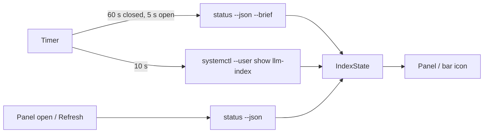

# Spec: an Omarchy shell plugin for llm-index status and settings

## Design

Two parts:

- this repository adds a machine-readable status and ships the plugin;
- nixos_config installs it on p620 and razer.

The plugin is QML only. All parsing, tier logic and redaction stay in Rust,
where the public MCP's rules already live.

### 1. `llm-index status --json [--brief]` (Rust)

- `src/main.rs:55`: `Status` gains `--json` and `--brief`. `--brief` requires
  `--json`. Without `--json`, the text output is unchanged byte for byte.
- `src/status.rs`: `run` takes the two flags. JSON mode prints one object on
  stdout and nothing else. Errors keep exit code 2 and go to stderr
  (`src/main.rs:142-148`).
- **`--brief` skips the two full-table counts** (`status.rs:65-68`).
  - `files` and `chunks` become `null`. Everything else comes from the small
    `roots` table, whose `queued`/`done` are kept live (`index/store.rs:583`,
    `:633`).
  - Measured on p620 on 2026-11-15: the `roots` reads take about 3 ms against
    3.1 s for full `status`.
  - The plugin's background check uses `--brief`.
- **Owner view, path-free.** JSON mode builds on `build(store, false)`, then
  changes two things:
  - **Reasons:** a reason is kept only if it is a state word, `mount`, an errno
    name (the existing `public_reason`, `status.rs:33`), or one of the
    scheduler's fixed reasons (`identity mismatch`, `watch degraded`,
    `symlink in path`, and the other literal reasons the implementer finds in
    `src/index/`). Anything else becomes `other`. Worker-supplied text such as
    `WatchDegraded { reason }` (`index/sched.rs:494`) can hold a path, which is
    why it isn't passed through.
  - **Config errors:** each becomes `{"root": <name or null>, "what": "root" |
    "exclusion", "reason": <filtered>}`. The root is the configured root whose
    path equals or contains the error path. The path itself is dropped
    (intent decision 4).
- **Settings projection, from the parsed `Config`** (`config.rs:11-76`), path
  free:

  ```json
  "settings": {
    "roots": [{"name": "...", "tier": "public|private", "kind": "...", "interval": "...", "share": true}],
    "exclusions": 1,
    "lifted_builtin": ["..."],
    "limits": {"max_file_mb": 0, "max_text_bytes": 0, "max_cells": 0,
               "memory_max_mb": 0, "workers": 0, "backoff_max": "..."},
    "managed_by": "nix"
  }
  ```

  - `share` is a boolean (whether one is set): the share source names a device
    or server.
  - `lifted_builtin` lists built-in denylist names, which are fixed strings,
    not paths.
- Top-level `"generated_at"` (Unix seconds) lets the plugin show how old the
  data is.
- The MCP `status` tool is unchanged. It keeps its own public filtering.

### 2. The plugin (`plugin/` in this repository)

ID `olafkfreund.llm-index` (intent decision 5). It follows the shell's own
plugins: rebuild-panel's self-hiding bar widget, and the Process,
StdioCollector and KeyboardPanel patterns.

| File | Role |
| --- | --- |
| `manifest.json` | `schemaVersion: 1`, `kinds: ["bar-widget"]`, `entryPoints.barWidget: "Panel.qml"`, `barWidget` with `category: "System"`, `allowMultiple: false`, `defaultSection: "right"`. |
| `qmldir` | Declares `IndexState` and `Model.js`. |
| `Model.js` | Pure functions: parse and validate the JSON, compute `attention`, the tooltip, and number/time formatting. Holds all the logic, so it can be tested without a shell. |
| `IndexState.qml` | Non-visual. Runs the processes, holds the last good snapshot and its age, the unit state and an error category. |
| `IndexView.qml` | Panel content: a Status tab and a Settings tab, the action row, and a `ConfirmDialog` for Restart. Keys come from `PanelKeyCatcher`. |
| `Panel.qml` | The `BarIconButton`, sized 0 when there is no attention and the panel is closed (`rebuild-panel/Panel.qml:50-51`, `:83-84`), plus a `KeyboardPanel` hosting `IndexView` and the `IpcHandler`. |

#### Data flow and rates



- **Background (panel closed):**
  - `systemctl --user show llm-index.service -p ActiveState -p SubState -p
    Result` every 10 s;
  - `llm-index status --json --brief` every 60 s;
  - together, a few milliseconds a minute.
- **Panel open:**
  - one full `status --json` on open and on Refresh, about 3 s, with a busy
    marker;
  - `--brief` every 5 s for live queued/done;
  - file and chunk counts come from the last full run, labelled with its
    time.
- **One request of each kind at a time.** A run still going when the next
  tick comes is not doubled up. A 10 s deadline kills a stuck brief run, and
  60 s a full one.
- **Failure:** a non-zero exit or invalid JSON keeps the last good snapshot,
  marks it stale with its age, and shows a fixed error category (no stderr
  text). With no snapshot at all, the view shows "Status unavailable",
  never zeros.
- **Service down:** an `ActiveState` other than `active` overrides the roots'
  states in the header ("Stopped" or "Failed"), even though the databases
  still say `ok`.

**Attention** (in `Model.js`) is any of:

- the unit is not active;
- any root's state is not `ok`, including `pending`;
- any root has `last_scan` null (first index);
- any root has `queued >= 1000` (a large backlog; the constant is named in
  `Model.js`).

Private roots count (intent decision 3).

**Bar tooltip:** a fixed string with no names or numbers. It says
"llm-index: service stopped", "llm-index: a root needs attention" or
"llm-index: indexing", in that order of priority.

**IPC:** the target is `olafkfreund.llm-index.bar`, with `manageIpc: false`
as in rebuild-panel.

- It offers `toggle`, `open` and `close`.
- `status()` returns `{"attention": bool}` and nothing else, because IPC
  replies can reach any process.

**Actions:**

- **Refresh:** a full `status --json`.
- **Restart service:** behind `ConfirmDialog`. Runs
  `systemctl --user restart llm-index.service`, then refreshes. The unit's
  `ExecStartPre` runs the sandbox self-test (`nix/config.nix:194`).
- **Open log:** `omarchy-launch-floating-terminal-with-presentation
  journalctl --user -fu llm-index`, the same helper rebuild-panel uses
  (`RebuildState.qml:133-136`).
  - The journal can contain private paths. The owner opens it explicitly,
    and it shows in a terminal, not the shell (intent: the shell's own logs
    stay clean).

**Text safety:** every `Text` and `PanelSectionHeader` sets
`textFormat: Text.PlainText`. There are no links. The plugin has no
`console.log` of status data.

**The binary:** the plugin runs `llm-index` from the session PATH. The host
module already installs `cfg.package` (nixos_config
`hosts/common/nixos/llm-index.nix:47`). It uses the default config path, so
the plugin and the service read the same `config.toml`.

### 3. Packaging and checks (this repository)

- `flake.nix`:
  - `packages.${system}.plugin`, a copy of `plugin/` made with
    `lib.fileset`, separate from the Rust package (`nix/package.nix` fileset);
  - `checks.${system}.plugin`, which runs:
    - `qmllint` syntax checks, like nixarchy `tests/qml.nix`. The `qs.*`
      imports don't resolve outside the shell, so this checks syntax only;
    - a lint that fails if any `Text {`, `PanelSectionHeader {` or
      `tooltipText` binding lacks plain-text handling, or if any file uses
      `console.log` with a status variable or `sh -c`;
    - `qmltestrunner` offscreen on `plugin/tests/tst_model.qml`, which
      covers `Model.js`. The pattern is from
      `io.github.kristoferlund.webcam/tests/tst_model.qml`.
- Rust tests in `src/status.rs`:
  - the JSON shape;
  - `--brief` gives null counts;
  - the reason filter;
  - config-error redaction (no input path appears in the output);
  - the text output is unchanged;
  - a private root never appears in `build(_, true)` (already covered,
    kept).

### 4. nixos_config (a separate PR, after this repository merges)

In `hosts/common/nixos/llm-index.nix`, for both hosts:

- `programs.nixarchy.plugins."olafkfreund.llm-index".src` set to the
  `plugin` package, inside the user's Home Manager block.
- **Enabled once** through the existing `local.omarchy.enableOnce` (imports
  `omarchy-enable-once.nix`, as `omarchy-gmessages.nix` does).
  - Its hook enables a plugin once per host and leaves a marker, so a later
    disable sticks.
  - It never writes `shell.json` (`omarchy-enable-once.nix:1-3`).
- **Keybinding:** `local.omarchy.keys.extra` gets `SUPER + CTRL + ALT + I`,
  "llm-index", with action
  `omarchy-shell shell toggle olafkfreund.llm-index '{}'`. The chord is
  unused in `omarchy-keys.nix` and the host files, and the module fails the
  build on a duplicate (`omarchy-keys.nix:319-323`).
- **Menu row:** `programs.nixarchy.menu.extraEntries."apps.llm-index"`, with
  the same toggle action. It's declarative and merged into the generated menu
  (nixarchy `modules/apps.nix:1098-1112`), as nixos_config does for podman
  (`omarchy-keys.nix:294-309`).
- The flake input is bumped to the merge commit.

**Two departures from the intent's assumed defaults**, both for you to
confirm:

- **Q1 (enable).** The intent assumed enabling it by hand. nixos_config
  already has `local.omarchy.enableOnce`, which gives the same "on once,
  your later disable sticks" result without a manual step and without
  changing nixarchy.
- **Q2 (way in).** The intent assumed a keybinding, plus a menu row only if
  the plugin could add one itself. A plugin cannot add a menu row. A
  nixos_config menu row (`extraEntries`) is cheap and declarative, so the
  spec adds it.

### 5. Docs

- `docs/reference.md`: `status --json` and `--brief`, with the field list.
- `README.md`: a short "Desktop plugin" section.
- `docs/security.md`: what the plugin shows where. Private metadata appears
  only in the open panel, the tooltip and IPC carry none, and Open log is the
  explicit exception.

## Alternatives rejected

- **A standalone Omarchy app (C++/Qt).** It needs a window, its own backend,
  packaging and theme code for a status panel. Every comparable system
  surface (rebuild, podman, herdr) is a shell plugin.
- **A `menu`-kind overlay.** It's a full-screen overlay
  (`nixarchy.podman/Menu.qml:106-148`), too big for a status card. The bar
  widget can already be summoned from a key or menu row with
  `omarchy-shell shell toggle` (`shell.qml:1190-1242`).
- **Parsing the text `status`.** It's fragile, and it carries paths in
  config errors.
- **QML reading SQLite directly.** That bypasses the Rust visibility and
  redaction rules, and Quickshell has no SQLite.
- **A daemon-written status file or socket.** It's new daemon surface the
  intent excludes. `--brief` is already cheap enough.
- **Using the barWidget `schema` for plugin settings.** No renderer exists in
  the shell tree. The rates and threshold are constants until someone asks.
- **A runtime settings override.** Excluded by the intent.

## Risks

- **#14 first.** Until #14 is fixed, p620's `source` shows as offline, which
  is correct but noisy. The plan sequences #14 first (intent decision 6).
- **Shell helper drift.** `omarchy-launch-floating-terminal-with-presentation`,
  `omarchy-shell` and the `qs.Ui` components come from the Omarchy tree, not
  this repository. A shell update could rename them.
  - Mitigation: the plugin uses only what rebuild-panel, which ships with
    nixarchy, uses.
  - The VM can't run the shell, so this is checked live on p620.
- **The PlainText lint is a grep, not a parser.** A `Text` built some other
  way (such as `Label`) could slip past it. The check also fails on `Label`
  without `textFormat`.
- **The background `systemctl` and `--brief` processes** spawn a few processes
  a minute per session. That's negligible, but it's measured live.
- **`--brief` readers** open both databases read-only, alongside the
  indexer's WAL writer. WAL readers don't block the writer.
- **Hosts:** p620 and razer only. p510 is untouched.

## Verification

- `nix develop -c cargo test`, including the new status tests.
- `nix flake check`, covering the existing VM, fixture, closure and module
  checks plus the new `checks.plugin`.
- `llm-index status` text output is identical before and after on p620:

  ```bash
  diff <(old status) <(new status)
  ```

- Live on p620, then razer, after the nixos_config deploy:
  - `status --json --brief` takes under 50 ms; `status --json` parses with
    `jq`; no path appears in either output;
  - the plugin is enabled after login; `SUPER+CTRL+ALT+I` and the menu row
    open the panel;
  - the Status and Settings tabs match `llm-index status`;
  - stopping the service with `systemctl --user stop llm-index` brings up
    the indicator within 10 s with "service stopped". Restart from the panel
    clears it;
  - the tooltip and `omarchy-shell olafkfreund.llm-index.bar status` show no
    root name or number;
  - disabling the plugin in Setup > Plugins survives a re-login.
